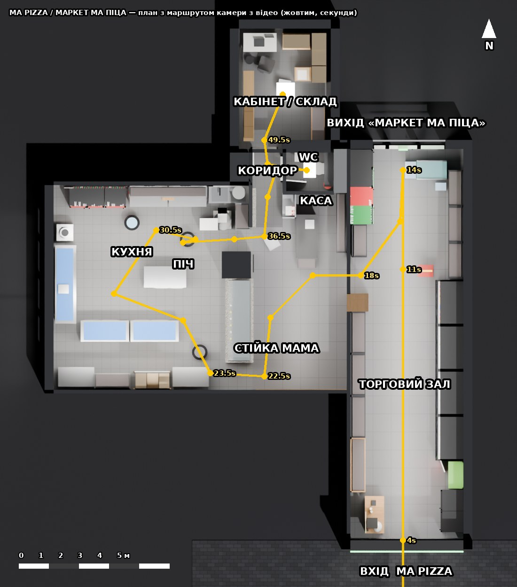

# 3D-макет приміщення «MA PIZZA / МАРКЕТ МА ПІЦА» для гри (Blender)

Модель магазину з піцерією, відтворена з відео-обходу (54 с, вертикальне відео). Людей не моделювали.
Решту відтворено в тому порядку, в якому камера проходить приміщення від входу з вулиці.



## Файли

| Файл | Що це |
|---|---|
| `ma_pizza_store.blend` | Готова сцена (Blender 4.2+ / 5.x), текстури запаковані всередину, відкривається на будь-якому ПК |
| `ma_pizza_store.glb` | Той самий макет у glTF 2.0 для ігрового рушія (Godot, Unity, Unreal, three.js) |
| `build_store.py` | Процедурний генератор сцени: з нього зібрано `.blend` і `.glb`. Усі розміри — константи на початку файлу |
| `make_textures.py` | Генератор текстур (плитка, дерево, граніт, панель «MAMA», крейдяні малюнки, товари, вивіски) |
| `annotate_plan.py` | Малює план із підписами зон і маршрутом камери з відео |
| `textures/` | Згенеровані PNG-текстури (без фото й без логотипів сторонніх брендів) |
| `renders/` | Контрольні рендери з тих самих точок, що й кадри відео, і план зверху |

## Маршрут відео → зона → камера в сцені

| Час у відео | Що видно | Камера в `.blend` |
|---|---|---|
| 0 с | Вітрина з вулиці, вивіска MA PIZZA, бруківка | `CAM_01_Street` |
| 2–4 с | Вхідні двері; ліворуч дерев'яна стійка з кавомашиною і шоломом, праворуч чорні холодильники та зелений стелаж | `CAM_02_Entry` |
| 5–14 с | Довгий прохід: праворуч відкриті холодильні гірки, далі стіна з чипсами, морозильна скриня; ліворуч хліб, бакалія, шоколад, 4 скляні холодильники; попереду білі двері з неоном «МАРКЕТ МА ПІЦА» | `CAM_03_AisleNorth` |
| 15–17 с | Розворот, погляд назад до вулиці: стійка з чипсами, дерев'яна колона | `CAM_04_AisleSouth` |
| 18–22 с | Прохід біля дерев'яної колони → чорна каса зі стійкою цукерок, піцерійна стійка «MAMA» | `CAM_05_Counter` |
| 22–33 с | Кухня за стійкою: коробки піци до стелі, вікна в чорних рамах, столи з синіми дошками, червоні холодильники, полиці й магнітні планки, мийки, бойлер, тістоміс, піч | `CAM_06_Kitchen`, `CAM_07_KitchenNorth`, `CAM_11_KitchenToCounter` |
| 35–37 с | Службовий прохід → каса з боку касира, монітори камер, стелаж з напоями | `CAM_12_CashFromStaffGap` |
| 37–39 с | Коридор: ліворуч відчинені двері кабінету, праворуч двері WC | `CAM_08_Corridor` |
| 40–48 с | Санвузол: підвісний унітаз, полиця з рулонами, чорний диспенсер, умивальник із дзеркалом | `CAM_09_WC` |
| 49–54 с | Кабінет-склад: вікно з плівкою «ДІЙСНО СМАЧНА ПІЦА!», стіл з ноутбуком, шафа, коробки піци до стелі, куртки, металевий стелаж | `CAM_10_Office` |

## Розміри (метри, реальний масштаб)

| Зона | Розмір | Стеля |
|---|---|---|
| Торговий зал (від вулиці до північних дверей) | 3,75 × 13,0 | 3,4 |
| Основний прохід | ≈ 2,0–2,25 | |
| Зона каси та стійки «MAMA» | ≈ 3,25 × 5,4 | 3,4 |
| Стійка «MAMA» | 2,8 × 0,9, висота 0,98 (+скло до 1,62) | |
| Кухня | 5,7 × 6,8 | 3,4 |
| Коридор | 1,0 × 2,6 | 2,8 |
| WC | ≈ 1,6 × 1,3 (внутрішній) | 2,8 |
| Кабінет-склад | ≈ 2,75 × 3,8 (внутрішній) | 2,8 |

Двері 0,8–1,0 × 2,05–2,25; холодильники 0,62–0,7 × 0,75 × 2,05; гірки 1,5 × 0,95 × 2,05; стелажі 2,0–2,2.

## Для гри

- Одиниці — метри, Z вгору в Blender (у `.glb` автоматично Y вгору). Початок координат — внутрішній кут
  східної стіни біля вуличного фасаду. +Y — північ, напрямок руху з відео.
- `PlayerStart_Street` (колекція `08_Game_Markers`) — точка старту гравця на вулиці перед входом, дивиться всередину.
  Там же порожні маркери зон (`Zone_Kitchen`, `Zone_WC` …) для тригерів.
- Усі двері — окремі об'єкти з початком координат на осі петель (`Door_Street_MA_PIZZA`, `Door_North_Market`,
  `Door_WC`, `Door_Office`): поворот навколо Z відчиняє/зачиняє їх.
- Колекції за зонами: `01_Architecture` (підлога, стіни, стелі, вітрини, вікна), `02_Sales_Hall`, `03_CashDesk_PizzaCounter`,
  `04_Kitchen`, `05_Corridor_WC`, `06_Office_Storage`. Світло для рендеру — `07_Lights_Render` (у `.glb` не експортується,
  в рушії світло ставиться своє; LED-лінії, неон, екрани та підсвітка холодильників — емісійні матеріали й експортуються).
- Легка геометрія: ≈ 6,5 тис. полігонів, ~90 об'єктів — підходить і для мобільного/вебу.

## Перезібрати після уточнення розмірів

```bash
pip install bpy pillow            # або запускати через встановлений Blender
python3 blender/make_textures.py  # тільки якщо змінювали текстури
python3 blender/build_store.py --out blender/ma_pizza_store.blend --glb blender/ma_pizza_store.glb --render blender/renders
python3 blender/annotate_plan.py
# або: blender -b -P blender/build_store.py -- --out blender/ma_pizza_store.blend --glb blender/ma_pizza_store.glb
```

Розміри зон і проходів — константи в блоці `LAYOUT` на початку `build_store.py`, розміщення обладнання — у функціях
`build_hall`, `build_counter_zone`, `build_kitchen`, `build_back_of_house`, `build_office`.

## Точність і припущення

- Рулетки у відео немає, тому масштаб взято зі стандартних розмірів обладнання (двері, холодильники, гірки,
  стелажі, плитка 60×60 і 30×30) та з часу проходу камерою. Похибка розмірів — орієнтовно ±10–15 %. Якщо дасте
  кілька реальних замірів (довжина залу, ширина кухні), їх достатньо змінити в `LAYOUT` і перезібрати.
- Взаємне розташування зон виведено з руху камери: розворот у кінці залу, поворот праворуч біля дерев'яної колони
  до каси, обхід стійки «MAMA» до кухні, вихід через службовий прохід у коридор. Найменш певні місця: точна орієнтація
  кабінету-складу і те, що лежить за межами кадру (там просто зовнішні стіни).
- Логотипи сторонніх брендів (кола, шоколад тощо) замінено нейтральними кольоровими упаковками — щоб модель можна було
  використовувати в грі. Вивіски самого закладу («MA PIZZA», «МАРКЕТ МА ПІЦА», «MAMA», «ДІЙСНО СМАЧНА ПІЦА!») збережено.
